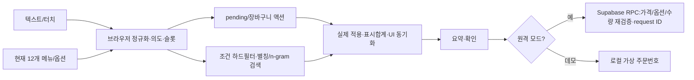

# HTI·UX·UI 최종 통합 명세

> AI응용 · 카페 키오스크 · 이지희 / 구범용 / 전서영 자료 통합  
> 수정일: 2026-10-14 · 작업 브랜치: `feature/hti-feedback`  
> 상태: **현재 구현과 목표 설계를 구분한 마스터 명세**. 구현·검증 상태는 아래 표를 기준으로 판단한다.  
> 실행 기준: `menu.json`, `rag-assistant.js`, `app.js`, `tests/`. 과거 기대 응답은 현재 테스트 결과와 같지 않다.

## 1. 범위·출처·데이터 기준

최상위 목표 0: **원하는 메뉴를 원하는 옵션으로, 확인된 금액에 안전하게 주문한다.** 실제 카드 승인·실시간 재고·외부 날씨는 범위 밖이다. 음성 입력 엔진/STT는 현재 연결하지 않았으며 대화 엔진의 검증 대상은 텍스트와 터치다.

| 범위 | 데이터와 목적 | 현재 실행 연결 |
|---|---|---|
| 12개 메뉴 | `menu.json`: 커피4·논커피3·티2·푸드3. 가상 카페 시연 가격·옵션 | 데모 메뉴. 원격 모드에서는 Supabase 메뉴·옵션 사용 |
| 162개 메뉴 / 219문서 | `카페키오스크_RAG문서/rag_docs/`: 음료77·푸드85 + 정책11·FAQ32·추천14 | 원본 감사·목표 RAG 설계 자료. 현재 검색 엔진에는 미연결 |
| 316개 공식 참고 스냅숏 | `reference/starbucks-official-menu-2026-10-14.json`: 음료198·푸드118·이미지316·공식 가격0 | 참고 자료. 전체 주문 가능 목록이 아님 |
| 과거 약15개 / 파일럿16개 | 과거 피드백 환경 / 범용 원본의 시연 후보 | 현재 메뉴 수와 혼용하지 않음 |

162개 자료의 가격에는 확인값·산출값·미검증값이 섞여 있고 일부 옵션가는 팀 설정이다(`카페키오스크_RAG문서/rag_docs/README.md`). 현재 Regular 아메리카노3,500원, Large+700원, 샷+500원, 디카페인+500원, 오트+700원은 **가상 카페 실행 데이터**이며 최신 공식 가격이라고 표현하지 않는다. 원격 모드의 최종 접수 금액은 Supabase RPC가 재검증한다.

| 출처 | 보존·통합 대상 | 참조 |
|---|---|---|
| 지희 | 상세 과업·근거·합격 기준·T01~T15·시연 계획 | `범용님이 코드 수정하고 주신 파일들/06_팀원자료/지희/이지희_HTI.md` |
| 범용·지희 통합안 | 0~6 과업, 과업별 책임·UI 피드백·구조화 계약·접근성 | `범용님이 코드 수정하고 주신 파일들/01_HTI·UX·UI 통합 설계.md` |
| 서영 | 12개 결함 집계·U1~U4·37개 원본 과업·Plan·N-1~N-10·13탭 배정 | `HTI_키오스크_주문과업_설계.md` |
| 피드백 PDF | 원인29개: P0 16·P1 10·P2 3. 이전 API 테스트41건 | `RAG_키오스크_피드백_통합본.pdf` |
| 현재 구현 계획 | 12/162/316 분리·3열·더블클릭·확장 단계 | `03_구현계획.md` |

제공된 서영 원본에는 P1 노인~P4 외국인이나 316개 대12개 감사표가 없다. 아래 P1~P4는 검토 요청을 반영한 **보강 사용자 모델**이다. 자료 출처와 신규 요구를 구분한다.

## 2. 원본 데이터 결함 감사와 정규화

다음 표는 **162개 가상 카페 자료의 원본 집계**를 보존한 것이다. 316개 공식 스냅숏이나 현재12개 실행 메뉴의 결함 통계로 해석하지 않는다. 마지막 열의 Step/N/D는 서영 원본의 절·규칙·보류 결정 ID다.

| # | 문제 | 근거(집계값) | 사용자 과업에 생기는 문제 | 해결 위치 |
|---|---|---|---|---|
| 1 | 상태값이 분류로 쓰임 | 카테고리 '시즌'에 1종(블랙 글레이즈드 라떼)만 있고 실제 `is_seasonal=true`는 12종. FAQ `list-seasonal`은 "1종", `seasonal-new`는 16종이라고 답함 | "시즌 메뉴 뭐 있어?"에 검색된 문서에 따라 1종 또는 16종으로 답이 달라짐 | Step 4 P3, N-1 |
| 2 | 포괄 분류 | '기타 음료' 15종 = 초콜릿 1 + 우유 2 + 병 주스·요거트 12 | 둘러보기(2.2)로 찾을 수 없음 | Step 4 |
| 3 | 브랜드명 분류 | '티바나' 16종(병 밀크티 보틀 포함) | 고객 언어가 아님, 제조 음료와 완제품이 섞임 | Step 4 P4·P5 |
| 4 | 논커피 = 무카페인 오해 | 커피가 안 든 음료 46종 중 22종이 카페인 있음, 8종은 60mg 이상(쿨 라임 피지오 100mg, 클래식 밀크 티 보틀 155mg 등). 또 커피 프라푸치노 4종이 `kind=noncoffee` | "커피 말고 카페인 없는 거"에 카페인 음료가 추천될 수 있음 | N-3, N-10 |
| 5 | 태그 중복·혼용 | '카페인없음'과 '카페인 없음'이 같은 24종에 둘 다 붙음. '진함'(음료 31) / '진한맛'(푸드 14). '논커피'·'디저트' 태그는 분류와 중복. '추운날' 태그는 0종인데 추천 문서는 있음 | 패싯 필터 결과가 표기에 따라 달라짐 | N-2 |
| 6 | 베스트 태그 오류 | '베스트' 태그는 돌체 콜드 브루 1종뿐이고, 설명문의 "베스트 x 베스트 조합" 문구에서 붙은 것. 실제 판매 순위 상위 메뉴 9종에는 없음. 정책 문서 `bestsellers`에 "None위"가 그대로 출력됨 | "제일 잘 나가는 거"에 잘못 답함 | N-9 |
| 7 | 알레르기 표기 혼용 | 달걀 계열 46종 중 '알류'만 10종, '달걀'만 21종, 둘 다 15종. 조개류도 '조개류'·'조개류(굴)'·'조개류(홍합)'·'조개류(전복)' 4가지 | "달걀 알레르기" 필터가 10종을 놓침 → **안전 문제** | N-4 |
| 8 | 사이즈와 가격 불일치 | 음료 30종에서 `sizes`와 가격이 있는 사이즈가 다름: Short 가격 없음 23, Grande·Venti 가격 없음 5, 우유(ICED인데 Short 가격만 있음), 골든 만다린 홉 피지오(사이즈 3개, 가격 1개) | 사이즈 선택(3.2)과 금액 계산(4.5)이 불가능한 조합이 화면에 나옴 | N-5, N-6 |
| 9 | 매장 제조 음료가 병제품으로 표시됨 | 더블 샷 3종이 "병·보틀 제품으로 퍼스널 옵션 없음". 원본 설명은 "핸드 쉐이킹한 음료". 단일 사이즈를 모두 병제품으로 처리한 생성 규칙(`build_rag_docs.py` 122행) 때문 | 옵션 설정(3.3)이 막힘 | Step 9 D3 |
| 10 | 데우기 필드 불일치 | 푸드 11종이 `can_be_warmed=null`(옵션 문구상 가능 7, 불가 4) | 3.4에서 필드마다 답이 다름 | N-7 |
| 11 | 푸드 카페인 정보 없음 | 푸드 85종 모두 `caffeine_mg=null`(초콜릿·티라미수 포함) | "카페인 없는 디저트"에 '없음'으로 잘못 답할 위험 | N-3 |
| 12 | 짧은 별칭 충돌 | 짧은 별칭 19개가 다른 메뉴 이름에도 들어 있음. 예: '말차'→퓨어 말차(말차 메뉴는 5종), '라떼'→카페 라떼(이름에 '라떼'가 든 메뉴 8종), '돌체'→돌체 라떼(돌체 콜드 브루·돌체 핑거 초콜릿도 있음). 별칭이 없는 음료 5종 | 이름 검색(2.1)이 사용자 의도와 다른 메뉴로 바로 확정됨 | N-8, 2.1.2 |

### 2.1 비율·심각도·해결 상태

원본에는 결함율·심각도 열이 없다. 새로 계산한 비율은 분모를 함께 기록한다. 카페인 함유/정보 없음 자체와 이를 오추천한 시스템 결함은 별개다. 항목들이 겹치므로 합산 결함율을 만들지 않는다.

| 지표 | 분자/분모 | 비율 | 검토 우선순위 및 상태 |
|---|---|---|---|
| 비커피 음료 중 카페인 함유 | 22/46 | 47.8% | P0: 논커피≠무카페인. 현재 엔진은 별도 하드 필터 |
| 음료 사이즈·가격 불일치 | 30/77 | 39.0% | P0: 원본 코퍼스 정비 미완료. 현재 12개는 Regular/Large 별도 체계 |
| 푸드 워밍 null | 11/85 | 12.9% | P1: 원본 재생성 미완료. 실행 메뉴는 치즈케이크 워밍 제외 |
| 푸드 카페인 미확인 | 85/85 | 100% | P0: ‘없음’으로 바꾸지 않음. 현재 푸드도 정보 없음 |
| 카페인 태그 중복 | 24/77 | 31.2% | P1: 코퍼스 N-2/N-3 정비 대상 |

### 2.2 원본 정규화 규칙 보존

| ID | 기준과 구현/목표의 경계 |
|---|---|
| N-1 | 분류·패싯·상태 분리. 시즌/신메뉴/베스트는 `status`로 이동. 162개 재생성은 목표 |
| N-2 | 통제 어휘 16개: 달콤함·상큼함·상쾌함·고소함·부드러움·크리미함·진함·쌉쌀함·깔끔함·담백함·짭짤함·매콤함·바삭함·쫄깃함·촉촉함·향긋함. 진한맛→진함, 은은함→향긋함, 알싸함→상쾌함. 시원함은 온도 속성. 현재 태그의 전면 변환은 목표 |
| N-3 | 원본 수치 단계: 없음 0 / 낮음 1~60 / 보통 61~199 / 높음 200mg 이상 / null정보 없음. 현재 12개 엔진의 높음·중간 등은 가상 카페 정성 분류이며 이 수치 단계와 동일하지 않음. 실제 mg·샷수는 없는 값을 생성하지 않음 |
| N-4 | 알류/달걀→알류(달걀), 조개류 4표기→조개류. 원시 성분표 보존. 견과류의 법정 표기 한계·교차오염 안내. 현재 성분 정보 부족 시 직원 확인, 안전 후보 임의 지정 금지 |
| N-5 | 원본 주문 가능 사이즈=가격 확인 사이즈∩온도 규칙(ICED Short 제외). 현재 12개 Regular/Large와 혼용 금지 |
| N-6 | 원본 가격 키 Short/Tall/Grande/Venti/Solo/Doppio/단일, Bottle/unsized 등→단일. 현재 12개 변환은 아래 별칭표 참조 |
| N-7 | 원본 워밍 null11종은 옵션 문구 기준으로 가능 7/불가 4 확정, 최종가능 19/불가 66. 현재 크루아상·휘낭시에는 선택, 치즈케이크는 워밍 없음 |
| N-8 | 원본 generic별칭 19개는 후보 확인, 별칭 없는 5개 보강. 현재 정확한 상품명/긴 별칭을 우선하고 겹치는 latte 중복 매칭을 제거. generic 후보 선택 상태의 전면 구현은 목표 |
| N-9 | 베스트 9종은 기간·출처 있는 순위만 사용, 돌체 콜드 브루 오태그/None위 수정. 원본 전체 재생성과 기간 검증은 미완료. 최신 공식 순위로 단정 금지 |
| N-10 | 원본 `kind`를 `browse.l0`+`contains_coffee`로 대체하여 커피 프라푸치노 4종 오분류 정비. 현재 12개 category ID와 별도 변환 필요 |

원본 D3(더블 샷 3종)는 **원본 확인 전까지 옵션 숨김**이다. 검증 없이 ‘옵션 복원 완료’로 바꾸지 않는다. 기타 D1~D9 보류 사항은 서영 원본 Step9에서 관리한다. 13탭(음료 6·푸드 7)과 162개 단일 배정표는 원본 Step4·부록A를 보존하며, 현재 화면은 전체/커피/논커피/티/푸드 5탭을 사용한다. 13탭 전환은 카탈로그 확장 단계의 별도 결정이다.

## 3. 사용자 모델과 과업 경로

| 원본 유형 | 목표 | 통합 과업 경로 |
|---|---|---|
| U1 단골 | 한 번에 이름·옵션·수량 말하기 | T1.1→T3.1~3.5→T4.3→T4.5 |
| U2 탐색 | 조건으로 후보 찾고 비교 | T1.3→T2.1/2.6→T2.4/2.5→T3 |
| U3 제약 | 건강·성분 제한을 유지 | T1.3→T2.2/2.3→T2.4→T3 |
| U4 묶음·선물 | 여러 품목 주문·수정 | T1.2→T3.1→T4.1/4.2 반복→T4.5 |

| 보강 페르소나 | 과업 경로·고려사항 | 현행 지원과 추가 검증 |
|---|---|---|
| P1 디지털 취약 노인 | T1.2→T3 단계별 질문→T4.3→T4.5. 쉬운 말, 큰 대상, 취소·직원 도움 | 누락 슬롯 순차 질문·터치/텍스트·aria-live 지원. 노인 사용성 시험·STT·직원 호출은 미실시/미구현 |
| P2 헬스·다이어터 | T1.3→T2.2/2.3→T2.4→T3. 무당/저당, 무카페인/디카페인, null 구분 | 복수 하드 필터·0건 안내·직원 확인. 영양 수치 확충·개인별 건강 적합성 판단은 제공하지 않음 |
| P3 바쁜 직장인 | T1.1+T3 일괄→T4.3→T4.5. 빠른 담기·부분 성공·수정 | 별칭·일괄 슬롯·더블클릭 기본 담기·기존 항목 수정. 피크시간 지연 측정은 별도 |
| P4 외국인·다문화 | T6.6→T1.1→T3→T4.5. 같은 언어·번역된 선택지·축약 영어 | 한국어/영어, I'd like/I'll have/Can I get 지원. 다국어 전면 지원·외국인 사용자 시험은 목표 |

U1~U4는 주문 방식, P1~P4는 사용자 특성이므로 서로 대체하지 않는다. 예: P3×U1, P2×U3, P4×U2. 접근성/언어 숙련도는 실제 사용자 평가로 검증해야 한다.

## 4. HTI 계층 구조: 6대 과업·31개 단위 과업

번호는 최상위 0→T1~T6→T1.1 등으로 통일한다. 서영 원본은 다른 분해 기준의 37개이며 18/7/7/5 처리 수치를 이 트리에 그대로 적용하지 않는다.

```text
0. 원하는 메뉴를 원하는 옵션으로, 확인된 금액에 안전하게 주문한다
├─ T1 요구 파악·탐색 (3)
│  ├─ T1.1 메뉴명·별칭 직접 찾기
│  ├─ T1.2 전체·카테고리 둘러보기
│  └─ T1.3 선호·제약·목적 밝히기
├─ T2 후보 검색·선택 지원 (7)
│  ├─ T2.1 범주·온도 필터
│  ├─ T2.2 카페인·당류·열량 조건
│  ├─ T2.3 알레르기·식이 확인
│  ├─ T2.4 단일 메뉴 설명·가격·옵션
│  ├─ T2.5 비교
│  ├─ T2.6 취향·상황 추천
│  └─ T2.7 식사·푸드 페어링
├─ T3 주문 구성 (6)
│  ├─ T3.1 단일·다중 메뉴 선택·담기
│  ├─ T3.2 온도
│  ├─ T3.3 크기
│  ├─ T3.4 샷·디카페인
│  ├─ T3.5 우유·기타 퍼스널 옵션
│  └─ T3.6 푸드 워밍
├─ T4 장바구니·주문 관리 (5)
│  ├─ T4.1 수량 변경·부분 취소
│  ├─ T4.2 기존 항목 옵션 수정
│  ├─ T4.3 품목·옵션·합계 확인
│  ├─ T4.4 포장·매장 선택
│  └─ T4.5 주문 요약·동의·접수
├─ T5 정책·FAQ (4)
│  ├─ T5.1 용량·기본 샷 체계
│  ├─ T5.2 추가금·제휴 혜택
│  ├─ T5.3 결제 수단·개인컵 혜택
│  └─ T5.4 워밍·매장 규정
└─ T6 예외·복구 (6)
   ├─ T6.1 누락·모호함 질문
   ├─ T6.2 조건 충돌·결과 없음
   ├─ T6.3 미판매·미제공 옵션
   ├─ T6.4 범위 밖 질문
   ├─ T6.5 내부 정보·실패 복구
   └─ T6.6 한국어·영어 대응
```

Plan0: `T1 → (T2 → T3)* → T4.3 → T4.5`이며 T4수정은 반복, T5/T6는 어느 단계에서나 끼어들 수 있다. U1은 T1/T2/T3의 여러 슬롯을 한 발화로 완료한다. T3은 **비어 있는 슬롯만** 온도→크기→워밍 순으로 질문한다. 질문 한 턴에는 우선 한 그룹을 제시한다. 정보 문의는 담지 않는다. 중간 가격·안전 질문은 pending을 보존하고 다음 명시 옵션으로 복귀한다. 새 메뉴 주문은 이전 미완성 주문을 대체한다.

### 4.1 원본 대응·성공 기준·구현 상태

서=서영 원본 HTI, 지=지희 원본 Task. 범용 통합안은 동일 계열의 1~6 ID를 사용한다. ‘로컬 검증’은 엔진/실제 UI 적용 함수 테스트를 뜻하며 실제 DB·사용성 시험의 통과를 뜻하지 않는다.

| 통합 ID | 원본 대응(서 / 지) | 성공 기준 | 상태·검증 |
|---|---|---|---|
| T1.1 | 2.1 / 1.1 | 표준 ID·별칭·오타, 상품 중복 매칭 없음 | 로컬 검증: 별칭·아바라·영문명 |
| T1.2 | 2.2 / 1.5.1 | 해당 범주 전체, 잘림 없음 | 로컬 검증: 전체 12·커피 4 |
| T1.3 | 2.3 / 2.1~2.2 | 조건을 추출하고 유지 | 부분: 알려진 조건만 지원 |
| T2.1 | 2.3.2 / 1.3.1 | 범주·온도 조건의 AND | 로컬 검증, 메뉴별 온도 데이터 확충 필요 |
| T2.2 | 2.3.2 / 2.2.1~2.2.3 | 0/저감/null 구분, 제한 완화 금지 | 로컬 검증: 무당·무카페인. 실제 영양 수치 확충 필요 |
| T2.3 | 2.3.2 / 2.3.1 | 안전을 보장하지 않음·미확인 후보 제외 | 로컬 검증: 확인 안내. 성분 필터 데이터 미완료 |
| T2.4 | 2.5 / 1.1~1.3 | 단일 메뉴, 모든 현재 사이즈 가격, 문의 시 cart 불변 | 로컬 검증: 가격·단일 카드 |
| T2.5 | 2.4 / 1.4.1 | 실제 필드만 비교·맛과 카페인 구분 | 로컬 검증: 없는 mg·샷수 생성 금지 |
| T2.6 | 2.3.1/2.3.3 / 2.1.1 | 후보·가격·이유·제약 일치 | 부분: 태그 추천, 상황 RAG 미연결 |
| T2.7 | 2.3.3 / 2.4.1 | 명시 페어링 요청, 판매 음료만 추천 | 로컬 검증: 고정 규칙·건강 필터 |
| T3.1 | 3.6 / 3.1.1~3.1.2 | 품목별 옵션·완성항목 즉시 담기·중복 없음 | 로컬 검증·브라우저 데모 |
| T3.2 | 3.1 / 1.3.1,3.2.1 | 선택지 1개 자동, 그룹값 1개 | 로컬 검증: 온도 정정 |
| T3.3 | 3.2 / 1.3.1,3.2.1 | 사이즈 별칭, M이요, 가격 일치 | 로컬 검증 |
| T3.4 | 3.3.1~3.3.2 / 1.2.1 | 허용 메뉴만 샷/디카페인 | 부분: 샷·디카페인만, half/blonde 미지원 |
| T3.5 | 3.3.3~3.3.6 / 1.2.1 | 허용 옵션만, 불가 옵션 거부 | 부분: 오트 지원, 시럽/휘핑 등 미지원 |
| T3.6 | 3.4 / 4.4.1 | 워밍 가능한 푸드만 질문 | 로컬 검증: 빵 2종·치즈케이크 제외. DB migration 적용 필요 |
| T4.1 | 3.5,4.2/4.3 / 3.5.1 | 취소량 정확·합계 즉시 재계산 | 로컬 검증:2잔중 1잔·set_qty |
| T4.2 | 4.2 / 3.5.2 | line ID 기반 수정·중복 없음·모호하면 확인 | 로컬 검증 |
| T4.3 | 4.5 / 3.4.1 | 현재 카탈로그 재계산·품목/옵션/수량/합계 | 로컬 검증, 최종 서버 금액은 접수 RPC |
| T4.4 | 1.2 / 3.6 | 선택 상태가 주문 payload와 일치 | 터치 버튼 지원. 자연어 변경은 목표 |
| T4.5 | 5.3~5.4 / 3.6 | 요약→동의→번호, 성공 후 cart 비움·실패 보존 | 로컬 검증·브라우저 데모. 실제DB 접수 미검증 |
| T5.1 | 6.1 / 4.1.1 | 용량·기본 샷의 검증된 근거 | 목표: 정책 RAG 미연결 |
| T5.2 | 5.1,6.1 / 4.2.1 | 현재 추가금과 혜택 출처 구분 | 부분: 가격 계산 지원, 정책 질의 미연결 |
| T5.3 | 5.1~5.2 / 4.3.1 | 가상 정책·결제 승인 구분 | 터치 결제수단 선택, 할인·FAQ 목표 |
| T5.4 | 6.1 / 4.4.1 | 확인된 워밍·매장 규정 | 옵션 지원, 정책 설명 목표 |
| T6.1 | 2.1.2,3.x / 5.2.1 | 필요한 것만 질문, 잘못된 수량·모호한 line 미적용 | 로컬 검증, generic별칭 선택 상태는 목표 |
| T6.2 | E3/E4 / 5.4.2 | 조건을 몰래 완화하지 않는 0건 안내 | 로컬 검증 |
| T6.3 | E1/E3 / 5.1.1 | 미판매/불가 옵션으로 주문 생성 금지 | 로컬 검증: 자허블·와퍼·치즈케이크 워밍 |
| T6.4 | 6.3 / 5.3.1 | 범위 안내, 주문을 임의 변경하지 않음 | 로컬 검증. 확인대기중 새 화제는 확정 취소 |
| T6.5 | E8/E9 / 5.4.1~5.4.2 | 내부 비밀 은닉·실패 보존·재시도 중복 방지 | 로컬 검증 및 SQL 계약, 실제 DB 장애 시험 필요 |
| T6.6 | 보강 / 원본 공통응답 | 영어 축약·선택 그룹·옵션·언어 변경 | 로컬 검증: KO/EN, 기타 언어 목표 |

## 5. 대화 상태·슬롯 계약

```text
탐색 → 메뉴명 확인 → pending(온도→크기→워밍) → 검증·완성항목 적용
  ↑         ↓ 새 메뉴이면 기존 pending 대체           ↓
  └── 정보/가격/안전 질문 후 명시 옵션으로 복귀 ← 장바구니 조회·수정
                                                ↓
                                 reviewing(내용 signature) → 네/yes
                                                ↓
                                  접수중 → 성공:번호+cart비움
                                         → 실패:cart+reviewing보존
```

| 슬롯 | 필수/기본값 | 검증 |
|---|---|---|
| 메뉴 | 필수·기본값 없음 | 현재 판매 ID, 긴 별칭 우선, 미판매 ID 담기 금지 |
| 수량 | 기본 1 | 정수 1~20.0/음수/소수/과다 거부. ‘2잔중 1잔취소’는 취소량 1 |
| 온도/크기 | 복수 선택지면 필수 | 선택지 1개 자동, 같은 그룹 값 1개. 정정은 기존값 대체 |
| 추가 옵션 | 선택·기본 없음 | 허용 메뉴와 옵션 ID 대조, 오트/샷/디카페인만 현재 지원 |
| 워밍 | 가능한 푸드의 복수 선택지일 때 | 크루아상/휘낭시에 질문, 치즈케이크 미제공 |

- 문장 내 품목 구절별로 옵션을 연결한다. 전체 문장의 옵션을 모든 메뉴에 복사하지 않는다. 연결 표현 없이 적용 대상이 모호한 문장은 추가 확인이 필요하다.
- 복합 주문에서 완성항목은 즉시 실행하고 **미완성항목만** 보존한다. 다음 턴에 이미 담은 품목을 다시 추가하지 않는다.
- 다중 pending의 이름 없는 답은 현재 첫 항목만 채운다. ‘둘 다/both/모두’일 때만 공통 옵션을 적용한다.
- `M이요`, `아이스로`, `아바라` 등 입력을 정규화한다. 아바라는 ICE를 포함한 바닐라 라테 별칭이다.
- `네`는 reviewing일 때만 접수를 승인한다. 단순 긍정으로 누락 옵션을 임의 선택하지 않는다. `취소/아니요`는 pending만 취소하고 담긴 메뉴를 보존, `장바구니 전부 비워`는 cart와pending 모두 초기화한다.
- reviewing은 메뉴·옵션·수량·금액·주문유형 signature를 저장한다. 내용이 바뀌면 기존 동의로 접수하지 않는다. 접수중 중복 실행은 차단한다. 접수 실패는 기존 request ID를 보존하여 재시도한다.
- 엔진은 상태를 외부로 반환하는 순수 함수이며 서버 세션을 저장하지 않는다. 브라우저가 `ragPendingOrder`·cart를 유지한다. 새로고침·새 기기 복원은 지원하지 않는다.

### 5.1 현재 사이즈·별칭 매핑

| 입력 | 현재 코드 | 주의 |
|---|---|---|
| 중/중간/미디엄/M/R/Tall/톨 | Regular | 공식 Tall 용량·가격과 동일하다고 주장하지 않음 |
| 큰/라지/L/Grande/그란데/Venti/벤티 | Large | Grande와Venti가 현행 2단계 체계로 압축됨 |
| 작은/S/Short/숏 | Small이 있으면Small, 없으면Regular | 현재 Small 미제공. 용량 동등성 보장 없음 |
| 뜨아/따아 | 아메리카노+HOT | ICE와 동시에 지정하면 확인 |
| 아아 | 아메리카노+ICE | 공백·조사 별칭 처리 |
| 그린티라떼 | 말차 라테 | 현재 menu ID `matcha-latte` |
| 아바라 | 바닐라 라테+ICE | `vanilla-latte` |
| 자허블 | 자몽 허니 블랙 티를 가리키는 미판매 요청 | 현재 12개에 없으므로 주문 불가. 162개 코퍼스와 변환은 목표 |

원본 `caffe-americano`는 현재`americano`, `caffe-latte`는 현재`cafe-latte`, 원본ICED는 현재ICE로 대응하지만 원본 가격/영양은 자동 복사하지 않는다.

## 6. 엔진·UI 구조화 계약

현행 계약은 `respond({message, items, options, cart, history, pendingOrder, orderType, language})` → `{intent, answer, language, retrieved, action?, pendingOrder?, replacePending?}`다. 원본의 `cart_actions/ui_action`은 목표 형식이며 현행 필드와 혼용하지 않는다.

```json
{
  "intent": "clarify",
  "language": "ko",
  "answer": "치즈케이크 요청을 확인했습니다. 아메리카노 온도를 선택해 주세요.",
  "retrieved": [{"id": "americano"}, {"id": "cheesecake"}],
  "action": {"type": "batch", "actions": [
    {"op": "add", "itemId": "cheesecake", "quantity": 1, "optionIds": []}
  ]},
  "pendingOrder": {"type": "pending", "itemId": "americano", "quantity": 1,
    "optionIds": ["size-large"], "missingGroups": ["온도"], "language": "ko"}
}
```

`retrieved`의 실제 값은 전체 메뉴 객체이며 위 예시는 ID만 발췌했다.

| 필드/조작 | 제약과 처리 |
|---|---|
| `action.type` | add / add_many / batch / remove / pending / pending_many / pending_batch / clear / checkout / confirm_order |
| `batch.actions[].op` | add / remove / update / set_qty. itemId 필수, lineId로 기존 line을 특정. quantity정수 1~20, update미지정은 기존수량 유지 |
| `optionIds` | 현재 메뉴에 허용된 ID만. 그룹별 1개·추가그룹 다중. 잘못된 ID/필수누락/충돌은 미적용 |
| `pendingOrder` | 필드 없음=기존 대기 보존, null=해제, 객체=미완성 주문/reviewing 교체 |
| `replacePending` | 명시적인 새 메뉴 주문 시 기존 미완성 상태 종료. 새 pending은 다시 저장 |
| 적용 결과 | `applyCartActions`→cart/changes/errors/total. UI는 실제 성공 결과와 최신합계로 답변 생성, 실패를 성공으로 말하지 않음 |
| 가격 경계 | 브라우저 표시합계는 현재 카탈로그 재계산, 요청 unitPrice 무시. 최종 접수는서버RPC 재조회. API가격조작 실검증은 별도 |

원본/요청상의 이름을 구현할 경우 어댑터 대응은 `selectMenu`→retrieved로탭/카드포커스, `addToCart`→add, `setQuantity`→batch.set_qty, `openCart`→현행 상시 주문내역이다. 이는 **매핑 설명**이며 이 이름의 별도 JSON enum을 현재 지원한다는 뜻이 아니다.

## 7. UI·HCI 원칙

- 입력창은 대화 영역 아래에 고정하고 대화 영역만 내부 스크롤한다. 새 메시지는 하단에 추가하며 최신 메시지로 내려간다. 상단 헤더·추천 버튼의 여백을 줄이고 화면 높이의 남는 공간을 메시지 영역에 배정한다. 작은 화면에서도 패널 높이를 확보한다.

- 대화는 오래된 턴부터 위에서 아래로 쌓이며 새 응답으로 하단 스크롤한다. 담기·수정·삭제 완료 응답은 실제 적용 결과와 합계만 보여 주고 기본가격의 메뉴 선택 카드를 붙이지 않는다. 주문 구성이 끝나면 이전 추천·옵션 버튼도 제거하여 불필요한 재선택을 방지한다.

- 옵션 대기 응답에는 현재 빠진 그룹의 클릭 가능한 버튼(HOT/ICE → Regular/Large)을 제공한다. 선택 중인 메뉴의 정보 카드는 다시 표시하지 않는다. 같은 추천 메뉴를 다시 선택해도 이미 선택한 옵션을 보존하며, 오래된 옵션 버튼은 현재 질문에 해당할 때만 반영한다.

- 추천 응답 안의 메뉴 카드는 **주문 선택**이다. 선택한 메뉴를 명시적 주문으로 전달하여 누락 옵션을 질문한다. 일반 정보 응답 카드와 메인 메뉴 카드 한 번 클릭은 정보 조회를 유지한다. 카드의 접근성 이름도 ‘선택하고 주문하기’와 ‘메뉴 보기’를 구분한다.

- 넓은 데스크톱(1280px 초과)은 메뉴 / 주문 도우미 / 주문 내역 3열이다. 중간 폭은 2열과 하단 주문 내역, 모바일은 세로 배치다. 메뉴 카드의 3열 그리드는 패널 배치와 구분한다.
- 메뉴 카드 한 번 클릭은 정보를 조회하며 현재 카테고리를 보존하고 이전 pending을 종료한다. 더블클릭은 기본 HOT·Regular·수량 1, 크루아상은 ‘그대로’, 휘낭시에·치즈케이크는 데우기 옵션 없이 즉시 담는다. 250ms로 클릭을 구분하고 세 번째 클릭은 무시한다. 기존 주문 카드를 눌러 옵션을 수정할 수 있다.
- 자연어는 누락된 필수 슬롯을 질문한다. 더블클릭은 기본값을 수락하는 별도 입력 정책이다. 키보드·텍스트 주문과 터치 편집 경로를 유지한다. 더블탭 접근성 및 고령자의 클릭 속도는 사용자 시험 대상이다.
- 대화 결과가 단일 카테고리면 해당 탭과 카드를 강조하고, 여러 카테고리면 전체 탭을 선택한다. 직접 카드 클릭은 현재 탭을 유지한다. 빈 결과·범위 밖 응답은 탭과 스크롤을 유지한다. 잘못된 ID는 무시하고 최신 requestId만 반영한다. 메뉴 강조가 페이지 전체를 이동시켜 대화 위치를 빼앗지 않도록 하며 독립 메뉴 스크롤 영역이 있을 때만 내부에서 이동한다.
- 추천은 노랑, 정보·비교는 초록, 주문은 빨강의 굵은 테두리로 강조한다. 메뉴명과 텍스트 응답을 함께 제공하며, aria-live로 실제 변경을 알린다. 키보드 포커스를 강제로 빼앗지 않고 reduced-motion에서는 즉시 스크롤한다.
- 현재 12개 이미지에 대체 텍스트와 출처·비제휴 안내를 제공한다. 푸드에 무의미한 사이즈·온도를 표시하지 않으며 금액은 천 단위 쉼표로 통일한다.
- 근거 패널은 현재 고객 화면에서 제거했다. 발표 근거는 조건·가격·테스트 증빙으로 제시하며 검색 점수·chunk ID는 고객에게 노출하지 않는다. 발표 전용 근거 뷰는 목표 기능이다.
- 대화 주문 요약은 채팅에 표시하여 다음 ‘네’ 입력을 막지 않는다. 터치 주문 버튼은 기존 확인 모달을 사용한다. 실제 카드 승인은 제공하지 않는다.

## 8. 현재 아키텍처와 목표 RAG



목표 구조는 **162개 카탈로그 정비 → 219문서 임베딩 → 벡터·어휘 하이브리드 검색 → 정책·설명 RAG → 구조화 출력 → 서버 적용 결과 기반 응답 검증**이다. 가격·영양 제약·옵션 검증은 결정적으로 처리한다. 현재 외부 LLM·임베딩·벡터 DB·서버 대화 세션은 연결하지 않았다. 따라서 예전 API의 rate limit·JSON 형식 오류를 해결했다고 주장하지 않는다.

## 9. 골든 시나리오·검증 기준

각 시나리오는 사전조건을 명시하고 독립적으로 시작한다. 현재가격기준이며 원본의공식식기대가격을복사하지않는다.

| ID | 입력·사전조건 | 합격 기준·증빙 |
|---|---|---|
| G01 | 전체메뉴 / 커피종류전부 | 현재 12개 / 커피 4개. `rag-session` 목록검증 |
| G02 | 아아 중사이즈얼마야? / 아메리카노얼마야? | Regular3,500, 전체가격Regular3,500/Large4,200, cart불변 |
| G03 | 아메리카노와카페라테진하기비교 | 가격·설명, 수치없음을고지, 더강하다고단정금지 |
| G04 | 카페인없고당류도없는따뜻한차추천 | 현재 12개에는검증된충족후보없음. 0건·조건 유지 |
| G05 | 우유알레르기인데라떼안전해? | 직원 확인, 미확인안전후보없음, cart불변 |
| G06 | 뜨아 하나 담아줘→레귤러 / 온도 정정:뜨아→아이스로→M이요 | 기본 흐름은 HOT/Regular1잔·3,500원. 정정 흐름은 ICE/Regular, HOT중복없음 |
| G07 | 아아톨 2잔보유→두잔중한잔취소총얼마 | 1잔·3,500원 |
| G08 | 아아톨 1잔보유→방금그거L로바꾸고샷추가 | 동일주문 1잔·ICE/Large/샷,4,700원 |
| G09 | 아메리카노큰거 1+치즈케이크 1담아줘→아이스 | 첫턴케이크 5,900담김, 다음턴음료 4,200추가,총 10,100·중복없음 |
| G10 | G09후결제할게요→네 | 품목/옵션/수량/합계요약,확인된내용만접수,성공번호+cart비움·실패보존 |
| G11 | unitPrice0원조작·잘못된옵션/수량 | 로컬재계산/거부검증. 실제API조작검증은미실시 |
| G12 | 자허블/와퍼/민트초코프라푸치노/치즈케이크데워 | 미판매·불가 옵션으로주문 생성안함 |
| G13 | I'd like/I'll have/Can I get a hot latte, medium, with oat milk | 영어응답,카페라테HOT/Regular/Oat,5,000원 |
| G14 | pending중가격문의·새 메뉴·취소·주문내용변경후네 | 정보 문의보존,새 메뉴교체,취소후긍정무접수,변경signature무접수 |

### 9.1 지희 원본 T01~T15 대응

원본은 미실행 계획이다. 원본의 메뉴명·가격·옵션을 바꾼 현재 테스트가 원본 41건 전수 재검증과 같다고 주장하지 않는다.

| 원본 | 현재 대응 | 판정 경계 |
|---|---|---|
| T01 | G02 | Tall→Regular 매핑,가상가격 3,500 |
| T02 | T3.5/G12 | 바닐라시럽현재 미지원,불가 옵션거부 |
| T03 | T6.3 | 프라푸치노현재 미판매,ICED전용코퍼스 검증은목표 |
| T04 | G03 | 카푸치노미판매,현재아메리카노/라테비교로수치환각방지 |
| T05 | T2.6 | 현재판매달콤음료와이유/가격 |
| T06 | G04 | 현재충족후보 0건,캐모마일/민트는미판매 |
| T07 | T3.4/G12 | 티디카페인미제공,유자민트티도미판매 |
| T08 | G05 | 오트변경으로알레르기안전보장금지 |
| T09 | G08 | 현재Large+샷가상금액,중복없음 |
| T10 | G09/T2.7 | 현재바스크케이크·아메리카노,대명사 케이크 선택 상태는추가 구현 대상 |
| T11 | G07 | 현재단가로부분취소·최신합계 |
| T12 | T6.1 | 모호한추천수락은임의 담기 금지,후보 선택 상태목표 |
| T13 | G06/T6.1 | 빠진필수슬롯순차 질문 |
| T14 | G12/T6.4 | 미판매/범위밖,구체적대안품질추가개선 |
| T15 | G10/G11 | 실제UI접수함수성공/실패모의검증,실제 DB장애시험별도 |

## 10. 피드백 29개 추적 및 남은 작업

상태: **로컬 검증**=자동/로컬데모에서확인, **부분**=일부지원/검증누락, **목표**=미구현, **운영확인**=팀의결정필요. P2도 3개포함한다.

| PDF ID | 항목 | 현재 상태·잔여 작업 |
|---|---|---|
| 1-1 P0 | 별칭/사이즈 | 로컬 검증:뜨아·따아·그린티·아바라·영어·M이요. 자허블미판매 고지 |
| 1-2 P0 | 성분/비교 | 부분:복합조건필터·미확인고지. 영양mg/g·샷수·알레르기정보확충필요 |
| 1-3 P1 | 메뉴규모 | 목표:현재 12개,40개이상확장·가격/출처검증 |
| 2-1 P0 | 의미검색 | 목표:외부임베딩/벡터/LLM미연결 |
| 2-2 P0 | 목록/조건 | 로컬 검증:전체범주/조건목록,단순추천 3개는목록조회와구분 |
| 2-3 P0 | 메뉴판 | 로컬 검증:처음 12개카드·전체메뉴 |
| 3-1 P0 | 의도/페어링 | 부분:명시페어링분기,가격분리. 미지원FAQ·고급의도추가필요 |
| 3-2 P0 | 후속문맥 | 로컬 검증:M이요·그룹정정·새 메뉴·pending 다중 분리,추천대명사상태는목표 |
| 4-1 P0 | 복합조작 | 부분:add/remove배치·단일update/set_qty·부분담기. 임의의 혼합 update 복문은 목표 |
| 4-2 P0 | 상태일치 | 로컬 검증:실제적용결과/합계응답·partial취소·수정 |
| 4-3 P0 | 옵션가 | 부분:현재카탈로그 재계산·모든현재사이즈가격,정책코퍼스미연결 |
| 4-4 P0 | 가격조작 | 로컬 검증+SQL계약:RPC재계산,실제 DB조작요청시험필요 |
| 4-5 P0 | 주문확정 | 로컬 검증:요약→네→데모번호·성공 시 cart 비움·실패/중복모의검증. 원격 접수 별도 |
| 4-6 P1 | 문의/부분담기 | 로컬 검증:정보조회cart불변·완료항목즉시담기·중복방지 |
| 5-1 P0 | 근거없는메뉴 | 부분:미판매/불가 옵션거부·정량 환각 금지,구체적대안개선 |
| 5-2 P1 | 내부용어/대안 | 부분:내부 요청 차단,LLM출력검증·재생성은미연결 |
| 5-3 P1 | 응답형식 | 로컬 검증:가격/이유/영어·UI덮어쓰기제거 |
| 6-1 P0 | rate limit | 목표:현재LLM호출없음. 원본API한도분석·2회연속실환경시험필요 |
| 6-2 P0 | JSON오류 | 목표:현행로컬객체계약 검증,API구조화출력/재시도미연결 |
| 7-1 P1 | 사진 | 로컬이미지 12개,브라우저표시. 사용권한/공개배포정책확인 |
| 7-2 P2 | 근거패널 | 부분:고객패널제거결정,발표근거뷰목표 |
| 7-3 P2 | 표시 | 부분:금액포맷·치즈케이크무옵션. 전체 반응형/보조기기 사용성 별도 |
| 8-1 P0 | 일정/제출담당 | 운영확인:발표일·담당·오전 9시마감·코드동결시점 |
| 8-2 P1 | 시연화면 | 운영확인:시연URL·주문탭·다른과제/내부표현미노출확인 |
| 8-3 P1 | HTI | 문서반영:6대/31단위·Plan·검증·5분선별 |
| 8-4 P1 | 구성/문서슬라이드 | 부분:현행/목표구조명세,실제슬라이드제작별도 |
| 8-5 P1 | 모델선택 | 운영확인:현재외부LLM없음명시,향후모델선정근거준비 |
| 8-6 P1 | 전후/한계 | 부분:14개집중점검전후·자동회귀. 원본 41건동일환경전후표필요 |
| 9-1 P2 | StepUp | RAG범위밖. 시연에서숨기고해당과제 별도 관리 |

## 11. 발표·제출·병합 기준

PDF는 발표 15분 + Q&A 5분, 지희 원본은 20분 구성을 기록한다. 실제 공지로 시간을 확인하기 전에는 어느 쪽도 교수님의 확정 요구로 단정하지 않는다. HTI에 5분이 배정된다면 다음 구성을 사용한다.

| 시간 | 내용 |
|---|---|
| 0:00~0:45 | 목표 0·6대/31단위 과업·12/162/316 범위 |
| 0:45~1:30 | U/P 사용자 경로·슬롯·부분 담기 규칙 |
| 1:30~3:30 | G09→G08 선별 시연: 케이크 즉시 담기→음료 온도→기존 항목 수정 |
| 3:30~4:20 | G04: 복합 제약 0건·조건 유지·근거 없는 수치 금지 |
| 4:20~5:00 | G10: 요약→네→데모 번호, 현재 한계와 남은 검증 |

14개 골든은 회귀 세트이며 5분에 모두 시연하지 않는다. 주문 접수는 실제 카드 승인 없이 데모 모드로 시연한다.

- [x] 현재 코드와 문서의 메뉴·가격·상태·액션 계약을 대조했다.
- [x] `npm test`·`npm run check`·`git diff --check`와 정적 빌드로 검증했다. 최종 실행 로그는 수정 완료 기록을 참조한다.
- [x] 실제 UI 적용 함수로 부분 담기·수정·합계·중복 방지를 검증했다.
- [x] 로컬 데모 브라우저에서 부분 담기→온도→요약→네→번호 흐름을 확인했다.
- [ ] 기존 DB에 `supabase/migrations/202610140007_disable_cheesecake_warming.sql`을 적용하고 원격 옵션·가격·접수·실패·중복을 시험한다. 로컬 검증 중 실제 DB는 변경하지 않았다.
- [ ] 원본 41건을 동일 입력·사전 조건으로 재실행하여 전후표를 완성한다.
- [ ] 임베딩 RAG·영양/성분 데이터·40개 이상 카탈로그·정책 FAQ·보조기기 사용성을 완성하고 검증한다.
- [ ] 발표일·제출 담당·시간 구성·마감·시연 URL·슬라이드를 확정한다.
- [ ] 필요한 변경 파일을 커밋하고 최신 main 기준으로 엔진·UI·메뉴·DB 계약을 검토한 후 PR·병합한다. `feature/hti-feedback`이라는 이름만으로 미커밋 변경의 격리를 보장하지 않는다.

배포 자산은 v59로 동기화한다. 기존 적용 migration은 수정하지 않고 새 migration을 추가한다. 현재 명세가 향후 작업의 전수 완료를 뜻하지 않으며 실제 서버·배포 검증 전에는 이를 완료로 표시하지 않는다.

### 후속 UI 정합성 보완 (v61)

비교 결과의 메뉴 카드도 “선택하고 주문하기”로 명시하고, 클릭 후 필수 옵션을 채워 장바구니에 담는다. 비교 발화 자체로는 주문하지 않는다. 조건 일치 메뉴가 없으면 조건을 임의로 완화하지 않고, 부드러운 문장으로 현재 메뉴에 없음을 안내한다.

### 푸드 데우기 정책 (v62)

현재 푸드3종 중 버터 크루아상만 데우기(따뜻하게/그대로)를 선택한다. 솔티드 휘낭시에와 바스크 치즈케이크는 데우기 슬롯이 없으며 단독·복합 주문 시 추가 질문 없이 담는다. 기존 DB용 `202610140008_disable_financier_warming.sql`을 준비했으며 실제 적용은 하지 않았다.
